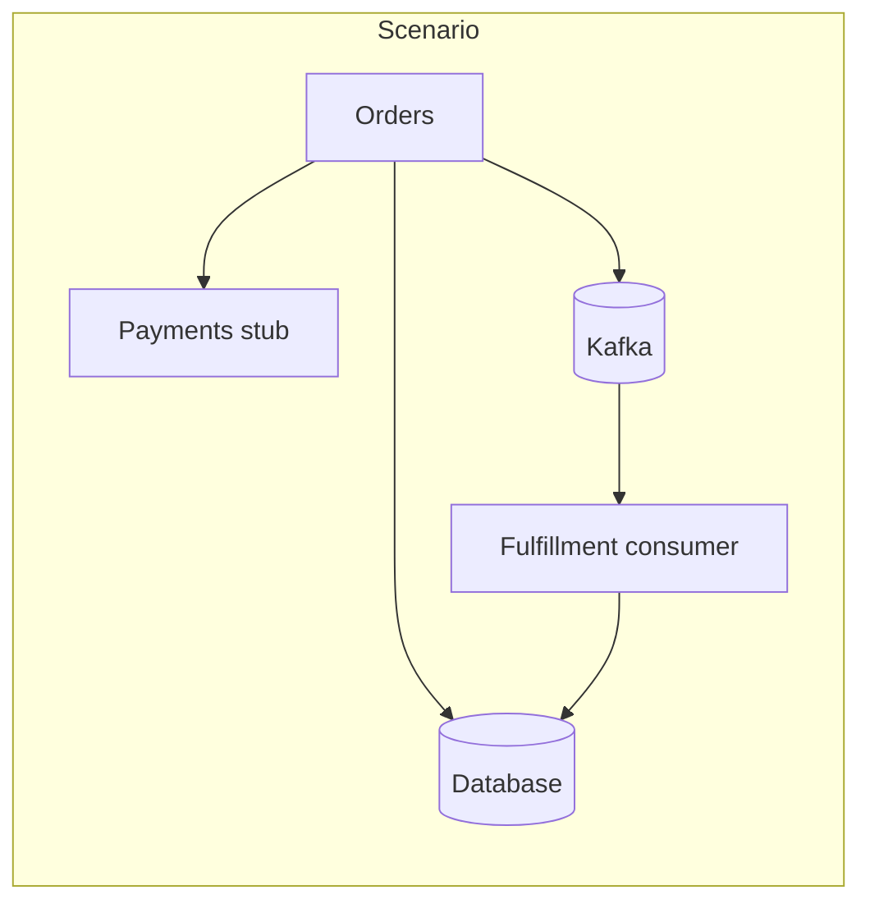
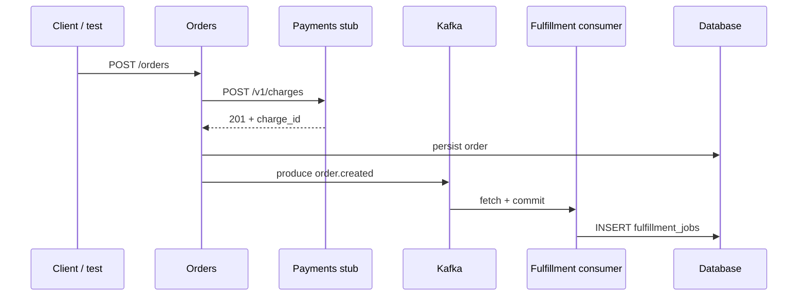

# Walkthrough — Orders + Payments (Kafka consumer + database)

**Purpose:** One green scenario where you prove **both** that Orders **published** to Kafka **and** that a **separate consumer** process **read** the event and **wrote a downstream database row** (e.g. fulfillment queue).

**When to use:** You need **end-to-end messaging** — not only “a record exists on the topic” but “our consumer actually processed it and persisted state.”

**Prerequisites:** [Walkthrough overview](walkthrough-orders-payments.md), [Quickstart](quickstart.md), [Glossary](../glossary.md). Read [Kafka producer only](walkthrough-orders-payments-kafka.md) first if the team is new to topic assertions.

**Repository layout:** [Recommended repository layout](walkthrough-orders-payments.md#recommended-repository-layout) — add `crates/fulfillment-worker/` (or your consumer name) beside `orders-service`; system tests in `integration-tests/tests/` often work well when **two** binaries are spawned.

---

## Glance

| You start | You assert |
|-----------|------------|
| Kafka, DB, Payments stub, **Orders** (producer) + **Fulfillment** consumer (second binary) | (1) **One** expected record on `orders.events` (2) **One** row in `fulfillment_jobs` after **bounded convergence** |





---

## Step 1 — Contracts

| Piece | Contract |
|-------|----------|
| Topic | `orders.events` |
| Consumer group | e.g. `fulfillment-test` — isolated per scenario if supported |
| Downstream table | e.g. `fulfillment_jobs(order_id, status, …)` — **one row per processed order** |

**Payments stub** — same as other walkthroughs (`chg_test_1`).

**Illustrative migration**

```sql
CREATE TABLE fulfillment_jobs (
  order_id   TEXT PRIMARY KEY,
  status     TEXT NOT NULL DEFAULT 'queued',
  created_at TIMESTAMPTZ NOT NULL DEFAULT NOW()
);
```

---

## Step 2 — Config

Orders and Fulfillment share **`KAFKA_BOOTSTRAP`** and **`DATABASE_URL`** (same DB is typical in the lab). Fulfillment needs its consumer group id via env.

```bash
export PAYMENTS_BASE_URL="http://127.0.0.1:9XXX"
export DATABASE_URL="postgres://..."
export KAFKA_BOOTSTRAP="127.0.0.1:3XXX"
export FULFILLMENT_GROUP_ID="fulfillment-test-001"
```

---

## Step 3 — Harness + processes

1. Kafka + DB + migrations + Payments stub.
2. Spawn **Orders** (producer).
3. Spawn **Fulfillment** consumer subprocess — runs until the test stops it.
4. `POST /orders` (same as other walkthroughs).
5. **Convergence:** do **not** assert the DB row immediately after HTTP 200; poll until the row exists or timeout.

---

## Step 4 — Two-part assertion

```rust
use std::time::{Duration, Instant};

// 1) Producer: exactly one message on the topic with expected payload.
let produced = ctx
    .kafka()
    .consume_json("orders.events", /* bounds */)
    .await?;
assert_eq!(produced.len(), 1);
let payload = &produced[0].value;
assert_eq!(payload["order_id"].as_str(), Some(order_id));
assert_eq!(payload["charge_id"].as_str(), Some("chg_test_1"));

// 2) Consumer: downstream row — poll until present (consumer lag).
let deadline = Instant::now() + Duration::from_secs(30);
let mut job_status: Option<String> = None;
while Instant::now() < deadline {
    job_status = sqlx::query_scalar(
        "SELECT status FROM fulfillment_jobs WHERE order_id = $1",
    )
    .bind(order_id)
    .fetch_optional(ctx.postgres_pool())
    .await?;
    if job_status.is_some() {
        break;
    }
    tokio::time::sleep(Duration::from_millis(100)).await;
}
assert_eq!(
    job_status.as_deref(),
    Some("queued"),
    "consumer never wrote fulfillment_jobs for order_id={order_id}"
);
```

Replace `ctx.kafka()` / `ctx.postgres_pool()` with your harness APIs. Prefer a Shakedown **convergence** helper if the crate provides one.

---

## Step 5 — Teardown

Stop **Fulfillment**, then **Orders**, then tear down containers.

---

## Understand

- **Why two steps:** Kafka publish and consumer commit lag are **not** instantaneous; the DB assertion needs a **bounded wait**.
- **Vs [Kafka only](walkthrough-orders-payments-kafka.md):** That doc consumes in the **test** to verify the producer. **This** doc verifies a **real consumer process** and its **DB** side effect.

---

## Refresher card

- **Processes:** Orders (producer) + Fulfillment (consumer).
- **Assert:** topic message **and** `fulfillment_jobs` row **after** convergence.
- **Not:** in-process mock of the Kafka client — real consumer, real DB write.
